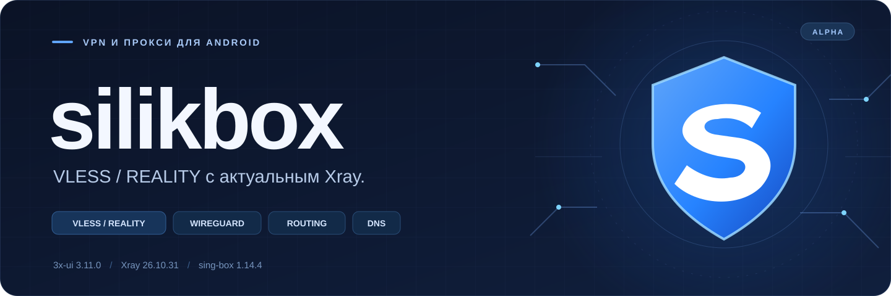

  

  <strong>Русский Android-клиент для ваших VPN-серверов и подписок.</strong> 
  VLESS / REALITY · WireGuard · Hysteria 2 · TUIC · гибкие правила маршрутизации

  
  

  
  
  
  

  <a href="#downloads">Установка</a> · <a href="#features">Возможности</a> ·
  <a href="#protocols">Протоколы</a> · <a href="#compatibility">REALITY и 3x-ui</a> ·
  <a href="#faq">Вопросы и ответы</a> · <a href="https://github.com/silikonoff/silikbox/issues">Поддержка</a>

---

## Что такое silikbox

**silikbox** — открытый VPN- и прокси-клиент для Android, который развивает **silikonoff** на основе NekoBox. Внутри — **sing-box 1.14.4** с нашим слоем совместимости старых профилей и Android-интерфейса.

Приложение объединяет серверы и подписки в одном месте: импортируйте профиль, выберите, какие приложения и адреса направлять через VPN, настройте DNS и подключайтесь. Для VLESS TCP / REALITY предусмотрен автоматический выбор совместимого варианта TLS-соединения без ручной смены `fp=chrome` в ключе.

silikbox работает с **вашим сервером или подпиской провайдера**. VPN-доступ и серверы в приложение не включены. Проект имеет статус **alpha**: доступные возможности и выполненные проверки перечислены ниже отдельно.

## Downloads — скачать для Android

**[Открыть Downloads →](DOWNLOADS.md)** — готовые установочные APK, версии и контрольные суммы.

| Текущая сборка | Где скачать |
| --- | --- |
| **silikbox 1.0.0-alpha2 · Android ARM64** | **[Скачать APK](https://github.com/silikonoff/silikbox/releases/download/v1.0.0-alpha2/silikbox-1.0.0-alpha2-arm64-v8a.apk)** |
| Описание выпуска, SHA-256 и отчёт проверки | [Релиз 1.0.0-alpha2](https://github.com/silikonoff/silikbox/releases/tag/v1.0.0-alpha2) |
| Все опубликованные версии | [GitHub Releases](https://github.com/silikonoff/silikbox/releases) |

### Первое подключение

1. Скачайте APK из **Downloads** и установите его на Android. Если система запросит разрешение на установку из выбранного источника, разрешите эту установку.
2. Добавьте профиль через **буфер обмена**, **QR-код**, **файл** или настройте его вручную. Для подписки создайте группу подписки и укажите её адрес.
3. Выберите профиль, запустите подключение и подтвердите системный запрос Android на создание VPN.
4. Проверьте соединение в приложении и откройте нужный сайт. При использовании правил часть трафика может идти напрямую — это определяется вашей настройкой маршрутов.

У оригинального NekoBox другой пакет: его можно оставить установленным рядом с silikbox. Android допускает одно активное VPN-подключение одновременно.

**Обновление наших прежних сборок:** пакет и сертификат подписи сохранены. Устанавливайте новый APK поверх NekoBox SB / NickMadBox без удаления приложения, чтобы сохранить его профили. Для переноса между разными приложениями экспортируйте нужные профили или резервную копию.

## Возможности

### Профили и подписки

- Импорт ссылок из буфера обмена, QR-кодов и файлов; ручное создание и редактирование профилей.
- Группы серверов, поиск, сортировка, удаление дубликатов и проверка доступности.
- Подписки с ручным и автоматическим обновлением, своим User-Agent и настройками обновления при подключении.
- Импорт поддерживаемых узлов из Clash / Clash Meta YAML, списков ссылок и Base64-подписок; импорт WireGuard `.conf`.
- Экспорт профилей и групп, обмен ссылками и QR-кодами.
- Цепочки прокси, входной и выходной прокси группы, группы с выбором сервера.

### VPN, маршрутизация и DNS

- **VPN-режим** для трафика Android и **режим локального прокси** для приложений с поддержкой прокси.
- Выбор TUN-стека: **gVisor, System или Mixed**; настройка MTU.
- Выбор приложений для туннеля и исключений из него.
- Правила по доменам, IP/подсетям, портам, приложениям и типу трафика; действия **прокси / напрямую / блокировать**.
- GeoIP / GeoSite и наборы правил; обход локальной сети, настройка IPv6 и распознавания трафика.
- Раздельные DNS для прямого и проксируемого трафика, DNS-маршрутизация и **FakeDNS / FakeIP**.
- DNS по UDP/TCP, **DoH**, **DoT**, **DoQ** и **HTTP/3** в зарегистрированных транспортах ядра.
- Локальный смешанный HTTP/SOCKS-вход; доступ из локальной сети включается отдельно в настройках.

### Управление и интерфейс

- Русский интерфейс, синяя тема по умолчанию, светлое и тёмное оформление.
- Собственная иконка со щитом **S** и отдельная установка рядом с NekoBox.
- Проверка соединения, статистика трафика профилей, скорость в уведомлении и журнал диагностики.
- Настройки автоподключения и сброса соединений при смене сети или пробуждении.
- Пользовательский JSON для расширенной настройки и собственные конфигурации sing-box.
- Clash API и встроенная веб-панель для дополнительного управления.
- Проверка обновлений из собственного репозитория **silikonoff/silikbox**.

## Протоколы

Здесь перечислены протоколы, для которых в текущем коде есть профили и обработчики. Наличие реализации означает доступность функции; проверка каждого сочетания сервера, транспорта и параметров ещё продолжается.

### Встроены в ядро

| Протокол | Возможности и особенности |
| --- | --- |
| **VLESS** | TLS, **REALITY**, поток **XTLS Vision**, uTLS; автоматическая совместимость Chrome для TCP / REALITY |
| **VMess** | TLS, uTLS и доступные V2Ray-транспорты |
| **Trojan** | TLS и доступные V2Ray-транспорты |
| **Shadowsocks** | Поддерживаемые ядром методы шифрования; дополнительные плагины требуют отдельного компонента |
| **Hysteria 1 и 2** | Встроенный UDP-вариант; для Hysteria 2 — Salamander и настройка смены портов |
| **TUIC v5** | Настройки QUIC, управления перегрузкой и передачи UDP; **TUIC v4 не поддерживается** |
| **WireGuard** | Профили и импорт `.conf`; адаптация к модели endpoint в sing-box 1.14 |
| **SSH** | SSH-туннель как исходящее соединение |
| **AnyTLS** | Отдельный профиль и встроенный обработчик ядра |
| **ShadowTLS** | Отдельный профиль для настройки ShadowTLS |
| **SOCKS** | SOCKS4, SOCKS4a и SOCKS5 |
| **HTTP / HTTPS proxy** | Подключение к HTTP-прокси с TLS или без него |

### Транспорты и TLS

Для подходящих VLESS / VMess / Trojan-профилей доступны **TCP/RAW, WebSocket, HTTP/HTTP2, gRPC, HTTPUpgrade и QUIC**. Поддерживаются параметры TLS, SNI, ALPN, uTLS и REALITY в соответствующих профилях. Конкретная комбинация определяется протоколом и настройкой сервера.

**XHTTP / SplitHTTP пока не реализован в текущем silikbox.** Добавление Xray для этого транспорта — следующий этап. HTTP/HTTP2 и HTTPUpgrade из списка выше являются отдельными транспортами.

### Внешние плагины

Интерфейс сохраняет поддержку **NaïveProxy, Mieru и Trojan-Go**, а также внешнего режима Hysteria для вариантов, которые не обслуживаются встроенным UDP-обработчиком.

Для них требуется **отдельно установленный совместимый плагин**. Его исполняемый файл не входит в наш APK; версии, наличие и совместимость таких компонентов проверяются отдельно. Для встроенных VLESS/REALITY, WireGuard, TUIC v5 или Hysteria 2 UDP плагин не требуется.

## REALITY, Xray и 3x-ui

**3x-ui управляет сервером; соединение устанавливается по параметрам профиля.** Для silikbox важны выбранные в панели протокол, транспорт, TLS/REALITY, SNI, ключ, Short ID и Flow.

| Настройка сервера / ссылка | Текущий статус |
| --- | --- |
| **VLESS + TCP/RAW + REALITY + Vision** | Основной проверенный сценарий; исходные Chrome-профили импортируются без ручной смены fingerprint |
| Другие встроенные протоколы и транспорты | Реализованы; проверка всех сочетаний продолжается |
| **VLESS + XHTTP / SplitHTTP** | Следующий этап с Xray; в текущем APK не поддерживается |

В нашем ядре добавлен автоматический выбор компактного современного REALITY ClientHello с запасными вариантами. Сохраняются X25519/ML-KEM и обязательная проверка подлинности REALITY. Поля сохранённого профиля при выборе варианта не переписываются.

Это собственная политика совместимости: фактический ClientHello может отличаться от точного отпечатка браузера, указанного в профиле. Подробности и возможность явного отключения политики описаны в [документации REALITY](docs/CHROME_COMPATIBILITY_ALPHA5.md).

## Что уже проверено

| Проверка | Результат и граница |
| --- | --- |
| Ядро и APK из чистых исходников | GitHub Actions собирает закреплённые исходники и выполняет проверки совместимости |
| Изолированный Xray **26.10.31** | REALITY, HTTPS upload/download и 8 параллельных соединений; неверный ключ отклоняется |
| Механизм REALITY на **TECNO KL7 / Android 14** | В предыдущей alpha5 проверены импорт, полный VPN, DNS/HTTPS, 1 МиБ, перезапуск, Wi-Fi и мобильная сеть |
| Структура установочного APK | Проверяются подпись, пакет, ARM64-библиотека, соответствие AAR и выравнивание 16 КиБ |

Историческая проверка alpha5 относится к механизму соединения. Новые сборки и оболочка проверяются отдельно; результаты конкретного выпуска находятся в **[Releases](https://github.com/silikonoff/silikbox/releases)**. Приёмка всех протоколов, Android-устройств, DNS/IPv6-сценариев, Always-on и Lockdown ещё не завершена.

## Вопросы и ответы

<strong>Где взять готовое приложение без самостоятельной сборки?</strong>

В разделе **[Downloads](DOWNLOADS.md)**. Для установки выбирайте подписанный `.apk` из Releases. GitHub «Source code» скачивает исходники; артефакт Actions у нас неподписанный и предназначен для проверки сборки.

<strong>Какой Android и процессор нужны?</strong>

Готовая alpha публикуется для **ARM64 / arm64-v8a**. Минимальный API проекта — Android 5.0 / API21; приёмка на всех старых системах не выполнена. Физическая проверка механизма REALITY выполнена на Android14. Для других архитектур готовых APK сейчас нет.

<strong>Будет ли работать ключ из NekoBox или подписка 3x-ui?</strong>

Импортируйте исходную ссылку или подписку. Поддерживаемые типы профилей и транспорты перечислены выше. VLESS TCP/REALITY с Chrome — основной сценарий нашей совместимости. Для XHTTP нужен будущий этап с Xray.

При импорте Clash / Meta YAML переносятся поддерживаемые узлы. Правила, группы и все настройки исходного клиента автоматически в полном объёме не переносятся.

<strong>Как перейти с NekoBox SB или NickMadBox?</strong>

Установите новый подписанный APK поверх нашей прежней сборки. Мы сохраняем пакет и сертификат подписи, повышая versionCode. Удалять приложение для обновления не требуется. Между оригинальным NekoBox и silikbox используйте экспорт/импорт профилей.

<strong>Профиль подключён, но сайты не открываются. Что проверить?</strong>

Убедитесь, что выбран нужный профиль и другое VPN-приложение не держит активный туннель. Выполните проверку соединения, проверьте транспорт и параметры сервера, затем DNS и правила маршрутизации. Для обращения в Issues укажите версию приложения, Android, протокол, транспорт и текст ошибки. Удалите из приложенных данных UUID, пароли, ключи и ссылки подписок.

## Развитие проекта

- [x] Перенос Android-моста и профилей на sing-box 1.14.4.
- [x] Автоматическая совместимость VLESS TCP / REALITY с Chrome-профилями.
- [x] Русский интерфейс, собственное оформление, отдельная установка и релизы.
- [x] Сборка закреплённых исходников в CI без передачи ключа подписи.
- [ ] Добавление Xray для **XHTTP / SplitHTTP**.
- [ ] Расширение проверки протоколов, плагинов, маршрутов и Android-устройств.
- [ ] Проверки сна, смены сетей, DNS/IPv6, Always-on / Lockdown для новых сборок.

## Для разработчиков

[Сборка](docs/BUILD.md) · [Изменения](docs/CHANGELOG.md) · [Перенос sing-box](docs/SINGBOX_1_14_PORT.md) · [Авторы и зависимости](docs/AUTHORSHIP.md)

Проверенный набор сборки: **Windows PowerShell, Go1.25.5, JDK21, Android SDK35 и NDK28.2**. Закреплённые libneko/gomobile включены в `third_party`; исходники sing-box загружаются по фиксированному commit и получают [наш патч](buildScript/patches/silikbox-core.patch). Стандартные Go/Maven-зависимости и внешние плагины имеют собственные источники и лицензии.

Ключ подписи установочных релизов остаётся у владельца. GitHub Actions выпускает **неподписанный** артефакт; он не заменяет APK из Downloads. Пользовательские профили, серверные конфигурации и ключи в репозиторий не включаются.

## Обратная связь и авторство

**Разработка и сопровождение: [silikonoff](https://github.com/silikonoff).** Ошибки и предложения — в **[Issues](https://github.com/silikonoff/silikbox/issues)**. При сообщении о сбое полезны шаги воспроизведения, версия APK и обезличенный фрагмент ошибки.

silikbox основан на **[NekoBox for Android](https://github.com/MatsuriDayo/NekoBoxForAndroid)** и предшествующем **[SagerNet](https://github.com/SagerNet/SagerNet)**. Благодарим авторов исходных проектов и зависимостей. История, исходное авторство и уведомления сохранены; наши изменения и выпуски сопровождаются независимо.

Лицензия — **[GPL-3.0-or-later](LICENSE)**. Подробности — в [AUTHORSHIP](docs/AUTHORSHIP.md).
